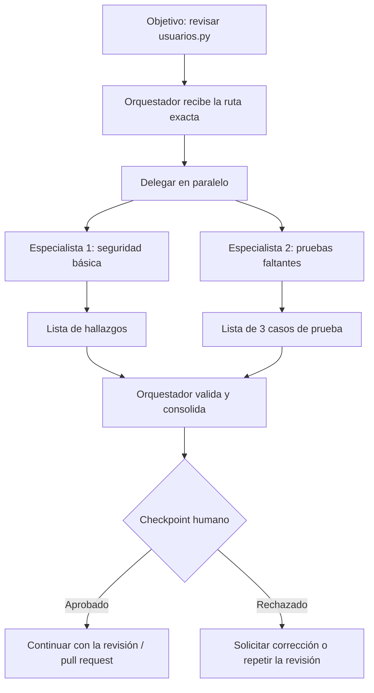

# Parte 1 — Diseña el equipo

## Equipo de agentes

El objetivo es revisar el archivo `usuarios.py` (ruta exacta relativa a la raíz del repositorio) antes de abrir un pull request. El orquestador recibe la ruta del archivo, la entrega a los dos especialistas y consolida sus resultados.

| Agente                     | Misión                                                     | Herramientas autorizadas     | Entrada          | Salida                                | Límites                          |
| :------------------------- | :--------------------------------------------------------- | :--------------------------- | :--------------- | :------------------------------------ | :------------------------------- |
| Orquestador                | repartir la revisión y consolidar                          | ninguna propia (solo delega) | ruta del archivo | tabla con hallazgos y casos de prueba | no modifica archivos             |
| Especialista 1 — Seguridad | buscar claves escritas en el código y entradas sin validar | leer, buscar                 | ruta del archivo | lista: línea, problema, severidad     | solo ese archivo; no escribe     |
| Especialista 2 — Pruebas   | proponer 3 casos de prueba que faltan                      | leer                         | ruta del archivo | lista: nombre del caso y qué verifica | solo propone; no escribe pruebas |

## Flujo de trabajo

Los dos especialistas trabajan en paralelo porque sus tareas son independientes. El orquestador espera ambas respuestas, las valida y las consolida. La persona revisa el resultado antes de permitir cualquier ejecución posterior, como abrir el pull request.



El checkpoint humano ocurre después de que el orquestador consolida y valida las respuestas, y antes de ejecutar cualquier acción sobre el repositorio o abrir el pull request.

## Revisión humana antes de aprobar

La persona comprueba que:

- La ruta revisada sea exactamente `usuarios.py`, relativa a la raíz del repositorio.
- Cada hallazgo de seguridad incluya una línea real de `usuarios.py`, un problema concreto y una severidad razonable.
- No se hayan inventado claves, tokens o entradas de usuario que no existan en el archivo.
- Los tres casos de prueba correspondan al comportamiento real de `usuarios.py` y expliquen qué verifica cada uno.
- Ningún especialista haya modificado el archivo ni haya escrito pruebas.
- La tabla final distinga claramente los hallazgos de seguridad de los casos de prueba.

La persona rechaza el resultado si aparece una línea inexistente, un hallazgo que no corresponde al código, un caso de prueba sin relación con el archivo, menos de tres casos de prueba, una salida sin evidencia suficiente o cualquier modificación no autorizada.

## Detección y manejo de fallos

El orquestador considera que un especialista falló cuando:

- Devuelve una salida vacía o incompleta.
- Cita líneas que no existen en `usuarios.py`.
- No respeta el formato de salida solicitado.
- Revisa otro archivo o intenta modificar el repositorio.
- El especialista de pruebas entrega una cantidad distinta de tres casos.
- El especialista de seguridad no indica línea, problema y severidad.

Ante un fallo, el orquestador no inventa ni completa la respuesta. Primero pide una corrección al especialista indicando el requisito incumplido y vuelve a delegar la tarea sobre el mismo archivo. Si el segundo resultado sigue siendo inválido, conserva el error como pendiente, avisa a la persona en el checkpoint humano y solicita su decisión antes de continuar.

## A2A

### Agent Card ilustrativa

*Simplificación didáctica; no es JSON conforme a una versión específica de A2A.*

La siguiente tarjeta describe a un Especialista 2 que pertenece a otro equipo. El dominio es ficticio y no contiene secretos ni endpoints reales.

```json
{
  "identity": {
    "name": "especialista-pruebas-remoto",
    "organization": "Equipo Ejemplo",
    "version": "1.0"
  },
  "description": "Agente remoto que propone casos de prueba para un archivo Python indicado.",
  "skills": [
    {
      "id": "proponer-casos-prueba",
      "name": "Pruebas faltantes",
      "description": "Propone exactamente 3 casos de prueba y explica qué verifica cada uno.",
      "input": "ruta y contenido autorizado de un archivo Python",
      "output": "lista de 3 casos con nombre y verificación"
    }
  ],
  "supportedInterfaces": [
    {
      "protocol": "A2A",
      "transport": "HTTP+JSON",
      "endpoint": "https://agente.ejemplo/a2a",
      "protocolVersion": "didactica-1"
    }
  ],
  "capabilities": {
    "streaming": true
  },
  "security": {
    "transport": "HTTPS",
    "authentication": ["OAuth 2.0 Bearer"],
    "requires": "token emitido por el equipo propietario"
  }
}
```

La Agent Card anuncia quién es el agente, qué skill ofrece, dónde recibe solicitudes, qué interfaz usa y qué seguridad exige. No ejecuta tareas ni demuestra por sí sola que el agente sea confiable.

### Descubrimiento y validaciones

El orquestador podría obtener la tarjeta mediante una URL conocida, por ejemplo `https://agente.ejemplo/.well-known/agent-card.json`, mediante un registro interno de agentes o mediante configuración previa. El cliente validaría:

- Que el origen y el certificado correspondan al dominio esperado y que la respuesta use HTTPS.
- Que la identidad y la organización sean las esperadas para este flujo.
- Que exista la skill `proponer-casos-prueba` y que su entrada y salida sean compatibles.
- Que la interfaz, el transporte y la versión anunciados sean compatibles con el cliente.
- Que la autenticación requerida esté disponible y se use sin colocar secretos dentro de la tarjeta.
- Que la tarjeta y, si existe, su firma o metadatos de integridad sean válidos.

Descubrir una tarjeta no implica confiar automáticamente en el agente. El cliente debe aplicar políticas de autorización, límites de datos, tiempo de espera y revisión del resultado.

### Secuencia de delegación

```text
obtener Agent Card
  → verificar skill, interfaz y seguridad
  → enviar mensaje con la tarea y el contexto autorizado de usuarios.py
  → recibir respuesta inmediata (Message) o una Task
  → si hay Task, consultar o recibir su estado
  → obtener el resultado como Artifact
  → validar el Artifact y enviarlo al checkpoint humano
```

Una solicitud A2A no siempre crea una Task: para una tarea sencilla el agente remoto puede devolver directamente un `Message`. Para una tarea prolongada puede devolver una `Task`, posiblemente con actualizaciones por streaming y un `Artifact` al finalizar.

### Estados y errores

En un camino simplificado, la Task pasa por:

```text
submitted → working → completed
```

`submitted` significa que la solicitud fue recibida; `working`, que el agente la está procesando; y `completed`, que terminó correctamente y puede entregar el Artifact. Si el estado es `input-required`, el cliente debe detener el avance, mostrar qué dato falta y pedirlo a la persona o al orquestador antes de continuar. Si el estado es `failed`, debe registrar el error, no inventar un resultado, aplicar una política de reintento segura o avisar a la persona para decidir si cambia de agente o cancela.

### Diferencia frente al subagente local y MCP

El subagente local de la Parte 2 vive dentro del harness de Codex, comparte el entorno de trabajo local y se invoca mediante la herramienta. A2A cruza una frontera de red y de organización: necesita descubrimiento, una interfaz interoperable, autenticación, límites de datos y una política de confianza más estricta. El agente remoto puede tener permisos, contexto y reglas diferentes, por lo que el orquestador debe tratar su respuesta como no confiable hasta validarla.

MCP conecta al orquestador con herramientas, archivos, servicios o recursos; A2A conecta al orquestador con otro agente que puede razonar y delegar una tarea de forma autónoma. Si el orquestador necesita acceder directamente a archivos o datos, puede usar una herramienta local o una herramienta expuesta mediante MCP. Si necesita delegar a un agente remoto una revisión autónoma, puede usar A2A. La elección depende de la arquitectura y de la interfaz de comunicación, no de que la tarea consista en leer archivos.

### Referencia conceptual

Esta explicación se basa en la especificación pública de A2A para Agent Cards, descubrimiento, mensajes, Tasks, estados y Artifacts, pero la tarjeta anterior es deliberadamente didáctica y no pretende ajustarse a una versión concreta: <https://a2a-protocol.org/latest/specification/agent-card/>.

