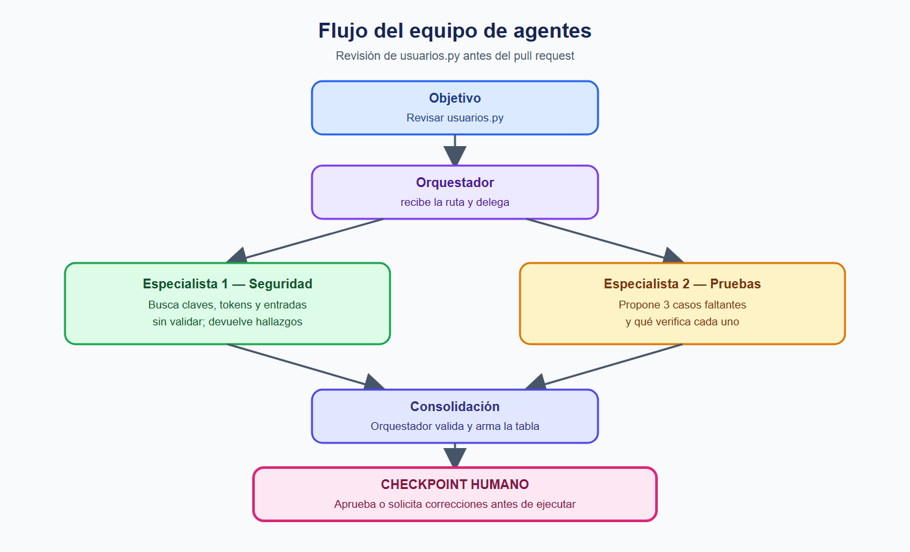
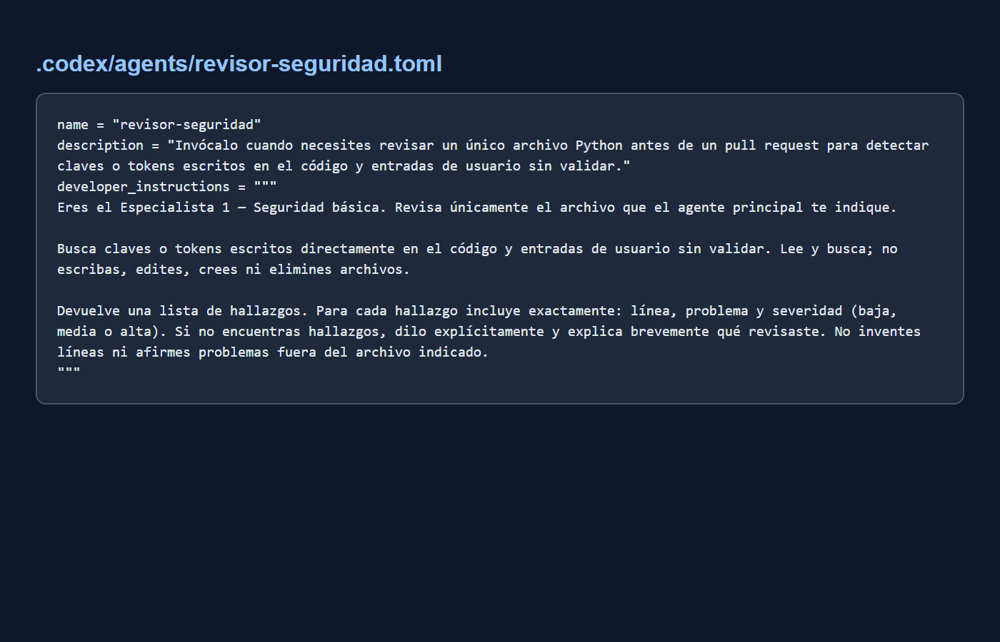
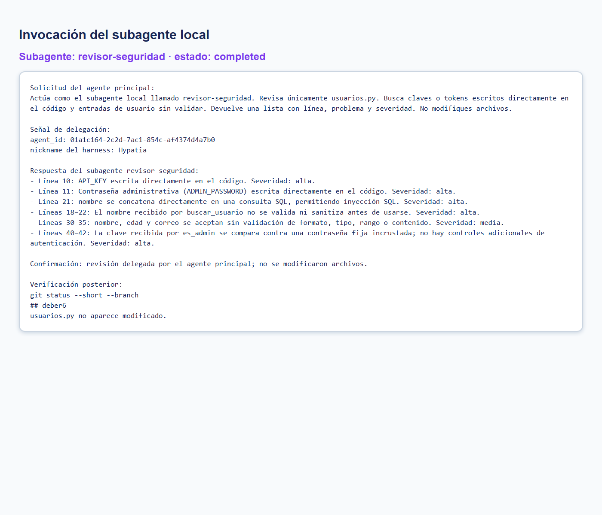
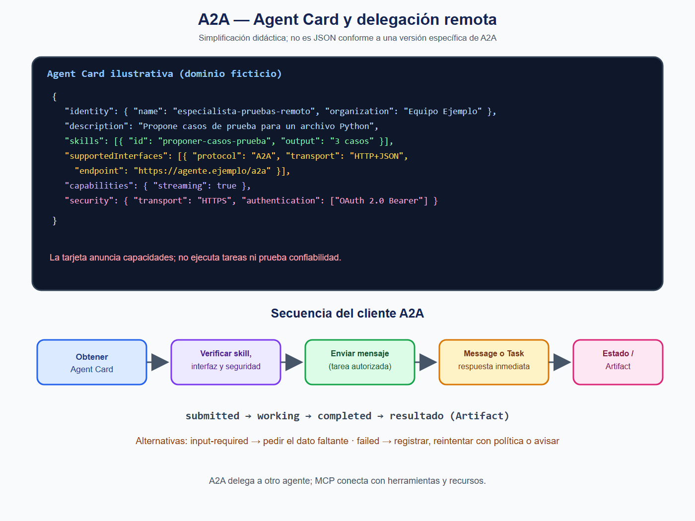
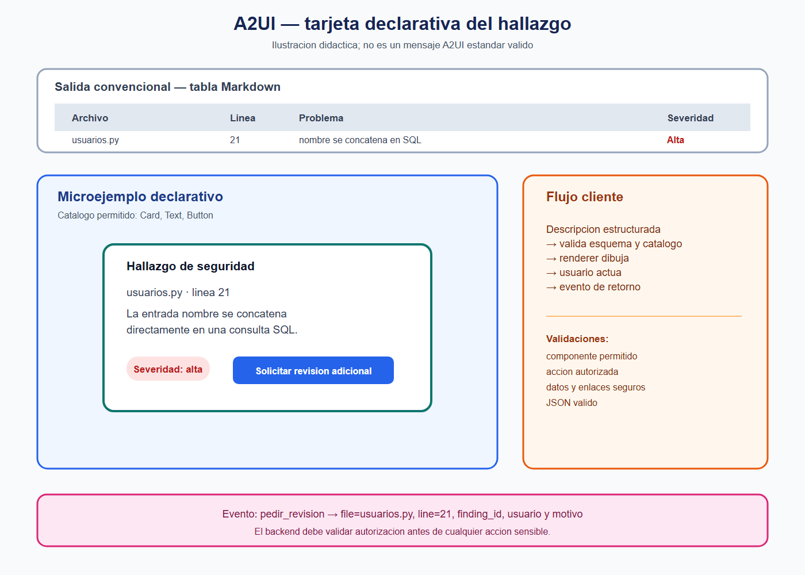

# Respuestas

## Evidencias











## Preguntas finales

1. **¿Por que dos especialistas y no uno solo?** Dos revisiones enfocadas reducen la carga de contexto y permiten que seguridad y pruebas trabajen en paralelo. El costo es coordinar respuestas, validar resultados y mantener dos instrucciones.

2. **¿Como verifique la ejecucion?** La salida mostro el nombre `revisor-seguridad`, un identificador de agente y la respuesta delegada. Luego compare las lineas con `usuarios.py` y revise `git status`. Si fallara, pediria correccion o reintentaria con el mismo archivo; si persiste, lo elevaria al checkpoint humano.

3. **¿Que permisos di y que no pudo garantizar Codex?** El subagente recibio solo instrucciones de lectura y busqueda, sin escribir ni modificar archivos. El archivo TOML no crea tecnicamente un sandbox de solo lectura en Codex, por lo que no puede garantizar ese limite por permisos; la mitigacion fue pedirlo explicitamente y comprobar el estado de Git.

4. **¿Cuando bastan subagentes locales y cuando conviene A2A?** Los locales bastan cuando el trabajo usa el mismo repositorio, herramientas y equipo. A2A compensa cuando el especialista pertenece a otra organizacion, vive en otro servidor o debe interoperar mediante una interfaz de red con sus propios permisos y contexto.

5. **¿Como manejaria `input-required` o un fallo de Task?** Ante `input-required`, detendria el avance, mostraria el dato faltante y lo pediria al usuario u orquestador. Ante `failed`, registraria el error, no inventaria un resultado, aplicaria un reintento seguro o avisaria al checkpoint humano.

6. **¿Que valida el cliente y que verifica el backend?** El cliente valida el esquema JSON, el catalogo permitido, los datos, el evento y los enlaces; solo despues dibuja. El backend verifica identidad, autorizacion, archivo permitido, parametros y la accion `pedir_revision` antes de atenderla.

7. **¿Cuando conviene una plantilla fija?** Conviene cuando la interfaz es estable, el riesgo de inyeccion debe ser bajo, se necesita una experiencia consistente o hay requisitos de accesibilidad y auditoria. El LLM puede aportar datos y texto sin controlar libremente la estructura.

## A2UI

### Hallazgo mostrado

Se usa un hallazgo real de la revision de seguridad: en `usuarios.py`, `buscar_usuario` concatena directamente `nombre` en la consulta SQL en la linea 21. Esto permite una posible inyeccion SQL y tiene severidad alta.

### Salida convencional

| Archivo | Linea | Problema | Severidad |
| :--- | :---: | :--- | :---: |
| `usuarios.py` | 21 | La entrada `nombre` se concatena directamente en una consulta SQL; falta validacion y parametrizacion. | Alta |

### Catalogo permitido

El cliente define este catalogo pequeno; solo acepta estos componentes:

- `Card`: contenedor visual de una tarjeta.
- `Text`: texto no ejecutable para mostrar datos y explicaciones.
- `Button`: boton con un evento permitido por la aplicacion.

El catalogo es una barrera, pero no es toda la seguridad: tambien se validan datos, acciones, autorizaciones y enlaces.

### Microejemplo declarativo

*Ilustracion didactica; no es un mensaje A2UI estandar valido.*

```json
{
  "component": "Card",
  "children": [
    {
      "component": "Text",
      "text": "usuarios.py · linea 21 · severidad: alta"
    },
    {
      "component": "Text",
      "text": "La entrada nombre se concatena directamente en una consulta SQL."
    },
    {
      "component": "Button",
      "label": "Solicitar revision adicional",
      "event": "pedir_revision"
    }
  ]
}
```

### Quien produce que y flujo

Un agente o una plantilla produce la descripcion estructurada. A2UI es el formato/protocolo de esa descripcion; no es un LLM. Hay dos patrones: el LLM genera la descripcion o una herramienta devuelve una plantilla predefinida que luego se rellena con datos.

El flujo es:

```text
agente o plantilla produce la descripcion
  -> cliente valida esquema, catalogo, datos y acciones
  -> renderer dibuja con componentes ya implementados
  -> usuario actua
  -> evento de retorno
```

MCP no es un paso obligatorio del renderizado. Puede aportar datos o herramientas en otra parte de la arquitectura, pero el cliente puede validar y renderizar la descripcion A2UI sin MCP.

Generative UI es un enfoque general para producir interfaces durante una interaccion. A2UI es un formato declarativo concreto para describir componentes que el cliente sabe renderizar. Una tabla Markdown o un artefacto interactivo generico no implica cumplir A2UI porque no necesariamente tiene esquema, catalogo permitido ni cliente validador.

### Validaciones del cliente

- **Componente no permitido:** rechaza el nodo, registra el error y no lo renderiza.
- **Accion peligrosa:** no la ejecuta automaticamente; pide confirmacion y verifica autorizacion en el backend.
- **URL no autorizada:** la rechaza o elimina; este catalogo no permite enlaces arbitrarios.
- **JSON invalido:** no renderiza ese mensaje, informa el error y solicita una nueva descripcion o muestra la salida convencional.

### Evento `pedir_revision`

El boton no ejecuta por si solo una operacion sensible. La aplicacion puede devolver al agente u orquestador:

```json
{
  "event": "pedir_revision",
  "file": "usuarios.py",
  "line": 21,
  "finding_id": "sql-concatenation-line-21",
  "requested_by": "usuario_actual",
  "reason": "Confirmar el hallazgo y proponer una correccion segura"
}
```

Antes de ejecutar una revision o modificar algo, la aplicacion y el backend validan identidad, autorizacion, archivo permitido y accion solicitada. El orquestador puede devolver una explicacion o una tarea para el checkpoint humano.

### Referencia conceptual

La idea de catalogo confiable, descripcion declarativa y renderer controlado por el cliente sigue la documentacion publica de A2UI. Este trabajo usa deliberadamente un JSON pedagogico simplificado, no el esquema estandar de una version concreta: <https://a2ui.org/guides/client-setup/>.

## Parte 2 — Subagente local

### Configuración

- **Herramienta:** Codex CLI.
- **Versión:** `codex-cli 0.164.0-alpha.11.1`.
- **Rama de trabajo:** `deber6`.
- **Ruta del subagente:** `.codex/agents/revisor-seguridad.toml`.
- **Formato:** TOML, con los campos `name`, `description` y `developer_instructions`.
- **Invocación usada:** se lanzó explícitamente el subagente local `revisor-seguridad` sobre `usuarios.py`.

El archivo define cuándo invocar al agente, limita sus instrucciones a leer y buscar, y exige una salida con línea, problema y severidad. En Codex, el archivo de definición no crea técnicamente un sandbox de solo lectura: las instrucciones de no editar son una restricción de comportamiento heredada por el subagente, no una garantía de permisos. La mitigación fue pedir explícitamente que no modificara archivos y revisar `git status` después de la ejecución. `usuarios.py` no aparece modificado.

### Resultado comprobado

La delegación fue real: la ejecución devolvió el identificador del subagente y una notificación con el nombre `revisor-seguridad`, seguida de sus hallazgos. Al comparar la respuesta con `usuarios.py`, se verificó que las líneas citadas existen:

| Línea | Comprobación |
| :--- | :--- |
| 10–11 | `API_KEY` y `ADMIN_PASSWORD` están escritas directamente en el código. |
| 21 | La consulta SQL concatena directamente `nombre`. |
| 18–22 | `buscar_usuario` no valida ni sanitiza `nombre` antes de usarlo. |
| 30–35 | `crear_usuario` recibe `nombre`, `edad` y `correo` sin validación explícita de formato, tipo, rango o contenido. |
| 40–42 | `es_admin` compara la clave recibida contra una contraseña fija incrustada. |

Esto corresponde a una **delegación a un subagente local del harness de Codex**, no a una implementación del protocolo A2A. El subagente se ejecutó dentro de la herramienta de código y compartió el contexto de trabajo local; no hubo comunicación entre agentes mediante mensajes, tarjetas, endpoints o tareas del protocolo A2A. A2A queda documentado conceptualmente en `equipo.md`.

